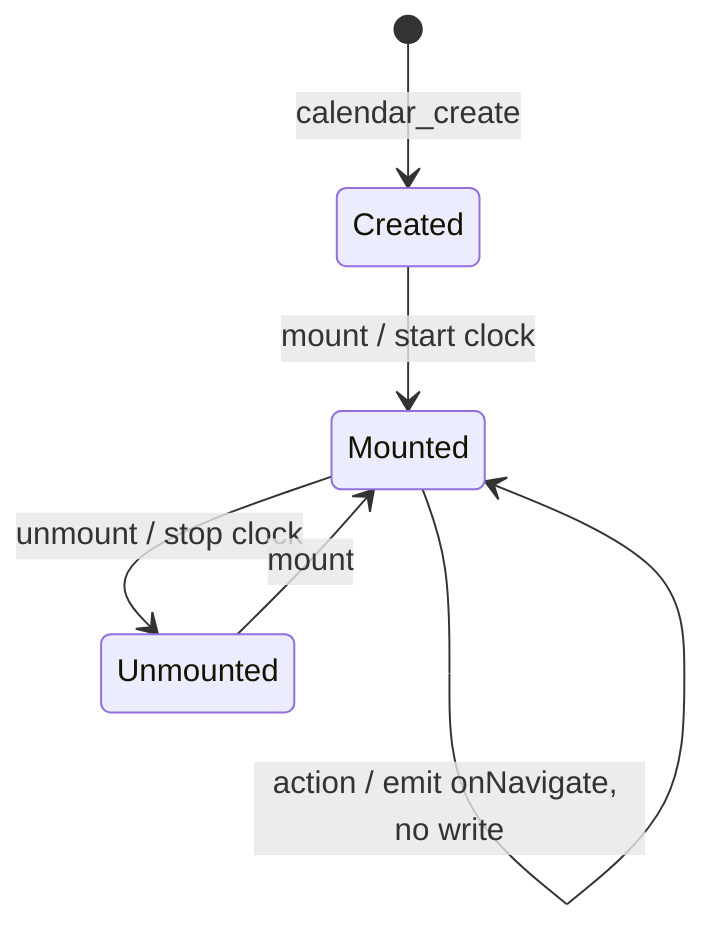

# Calendar — design spec

> Status: **core and React adapter implemented** (`packages/core`, `packages/react`)

> Moved from guildara-frontend (`lib/calendar`) to this repository. References to `lib/calendar/core` and
> `lib/calendar/react` now mean `packages/core` (`@calendar-tsx/core`) and `packages/react` (`@calendar-tsx/react`);
> "app R…" requirements refer to guildara-frontend's `docs/calendar-spec.md`, the calendar page this library was built for.

## Purpose & scope

A headless calendar library that satisfies `docs/calendar-spec.md` (R1–R11): a framework-agnostic core on TanStack Store, Temporal for all date math, a React adapter with Ark-style composable parts, and no styles.

- **In scope:** views, navigation and visible range, event layout, resources and availability shading, overflow, now indicator, click/focus targets, geometry exposed as CSS variables and data attributes.
- **Out of scope (consumer's job):** URL sync, header controls and selectors, data fetching, the drawer, drafts as data, colours and copy per event kind.
- **Not supported:** drag and resize, date selection, recurrence, timeline views.

### Working assumptions (from Stage 0, unconfirmed)

- ~~In-repo module with extractable boundaries~~ Settled by D21.
- Temporal through a polyfill; current browser support unverified.
- New dependencies: `@tanstack/store`, `@tanstack/react-store`.
- "Unstyled" still emits positional geometry (CSS variables), never visual styles.
- Must run on React 18.

## Capabilities

Library-level capabilities, each traced to the app spec. Draft; confirmed when the scope area closes.

- **C1 — Views:** month grid, day/week time grid with all-day row, list day/week, resource time grid. _(app R1.1–R1.4)_
- **C2 — Navigation:** current view and date, prev/next/today, go to date, change view; visible range and period derivable synchronously after any change. _(R2.3–R2.5, R3.2–R3.5, R8.1, R11.1)_
- **C3 — Change notification:** a single subscription that reports view/date changes, so the app can sync the URL. _(R2.1–R2.2)_
- **C4 — Time-grid layout:** overlapping timed events laid out side by side; rows do not stretch; slot labels formattable. _(R1.2, R1.7, R1.8)_
- **C5 — Event content:** consumer renders each event by kind and view; hiding is filtering the input (D16); consumer-defined order within a cell. _(R5.1–R5.8)_
- **C6 — Overflow:** a per-day row cap, an optional per-day overflow hint, and an overflow trigger the consumer handles (including async fill). _(R4.2, R6; D14, D17)_
- **C7 — Resources:** columns per resource in consumer order; events in every referenced column; per-resource availability ranges producing shaded "unavailable" segments; resource header state exposed. _(R7)_
- **C8 — Time zone:** all layout in a given time zone, independent of the host. _(R4.4)_
- **C9 — Now indicator.** _(R1.5)_
- **C10 — Day targets:** day cells and day headers addressable as interactive parts. _(R8.1)_
- **C11 — Min column width / horizontal scroll** for week and resource grids. _(R1.6, pending app Q1)_
- **C12 — Managed event state (opt-in):** a standalone event store with add/remove/update whose state feeds the calendar's `events` input. _(D2)_

## Composition

High-level shape after D1–D9; part lists per view are settled in the details pass.

**Core** (framework-agnostic, TanStack Store):

```ts
const calendar = calendar_create<Calendar_EventData>({
  timeZone: provider.timezone,
  views: {
    month: monthView({ maxEventsPerDay: 4 }),
    week: timeGridView({ days: 7 }),
    day: timeGridView({ days: 1 }),
    list_week: listView({ days: 7 }),
    list_day: listView({ days: 1 }),
    resources: timeGridView({ days: 1, groupBy: 'resource' }),
  },
  view: 'week',                                   // controlled (D5)
  date: Temporal.PlainDate.from('2026-03-02'),    // controlled (D5, D7)
  onNavigate: ({ view, date, range, period }) => {},
  events,                                         // input (D2)
  resources,
  firstDayOfWeek: 7,                              // Sunday
  eventOrder: (a, b, context) => …,               // context = active view snapshot (D16)
});

calendar.store.state;   // derived view model (D1), discriminated by layout kind
calendar.api.next();    // emits onNavigate; never writes state (D5)
calendar.api.goTo(date);
calendar.api.setView('day', date);
calendar.setOptions({ events });
```

**Managed events** (opt-in, D2):

```ts
const events = eventStore_create<Calendar_EventData>();
events.add(seeAll);
calendar_create({ events: events.store.state.events, … });
```

**React adapter:**

```tsx
const calendar = useCalendar<Calendar_EventData>({ timeZone, views, view, date, onNavigate, events, resources, clock });

<Calendar_RootProvider value={calendar}>
  <Header /> {/* useCalendarContext().api.next() */}
  <CalendarBody />
</Calendar_RootProvider>;

const CalendarBody = () => {
  const layout = useCalendarSelector(state => state.layout); // discriminated by kind (D10)

  return match(layout) // open union: prefer .otherwise() (D1)
    .with({ kind: 'month' }, month => (
      <MonthView_Root model={month}>
        {month.weeks.map(week => (
          <MonthView_Week key={week.key} week={week}>
            {week.days.map(day => (
              <MonthView_Day key={day.key} day={day}>
                <MonthView_DayTrigger day={day} />
                <MonthView_Overflow day={day}>see all</MonthView_Overflow>
              </MonthView_Day>
            ))}
            {week.segments.map(segment => (
              <MonthView_WeekEvent key={segment.key} segment={segment}>
                {segment.event.data.program.name}
              </MonthView_WeekEvent>
            ))}
          </MonthView_Week>
        ))}
      </MonthView_Root>
    ))
    .with({ kind: 'timeGrid' }, grid => <TimeGridView_Root model={grid}>…</TimeGridView_Root>)
    .with({ kind: 'list' }, list => <ListView_Root model={list}>…</ListView_Root>)
    .otherwise(() => null);
};
```

`TimeGridView_*` and `ListView_*` follow the same pattern; geometry arrives as CSS variables (D9).

## Anatomy

Every part renders `data-scope="calendar"` and its `data-part`, accepts a `render` prop (D25), and carries no styles (D9). Model props (`week`, `day`, `column`, `segment`, `event`) come from the view model the consumer loops over (D10).

**Shared**

| Part                                      | Role                                                                                                  | Owns |
| ----------------------------------------- | ----------------------------------------------------------------------------------------------------- | ---- |
| `Calendar_Root` / `Calendar_RootProvider` | Provides the instance; `Root` creates it from props, `RootProvider` takes one from `useCalendar` (D6) | —    |

**Month** (`kind: 'month'`)

| Part                                        | Role                                                                                                                                                       | Owns |
| ------------------------------------------- | ---------------------------------------------------------------------------------------------------------------------------------------------------------- | ---- |
| `MonthView_Root`                            | Receives the month model; `role="grid"`                                                                                                                    | —    |
| `MonthView_Header` / `MonthView_HeaderCell` | Weekday header row                                                                                                                                         | —    |
| `MonthView_Week`                            | One week row; `role="row"`; sets `--cal-rows`                                                                                                              | —    |
| `MonthView_Day`                             | One day cell; `role="gridcell"`, `data-today`, `data-outside`                                                                                              | —    |
| `MonthView_DayTrigger`                      | Button to go to the day (app R8.1)                                                                                                                         | —    |
| `MonthView_WeekEvent`                       | A bar in the week row; `--cal-col-start`, `--cal-col-span`, `--cal-row`, `data-continues-before/after`; button (D17)                                       | —    |
| `MonthView_Overflow`                        | "See all" button inside a day; renders when `day.hasMore` (local hidden rows or the `dayOverflow` hint); `data-hidden-count` is the local count (D14, D17) | —    |

**Time grid** (`kind: 'timeGrid'`; days and resource columns, D4)

| Part                                                | Role                                                                        | Owns |
| --------------------------------------------------- | --------------------------------------------------------------------------- | ---- |
| `TimeGridView_Root`                                 | Receives the time-grid model; labelled region                               | —    |
| `TimeGridView_Header` / `TimeGridView_ColumnHeader` | Column headers (date, or resource with `data-unavailable`)                  | —    |
| `TimeGridView_ColumnTrigger`                        | Button inside a date header to go to the day (app R8.1)                     | —    |
| `TimeGridView_AllDay` / `TimeGridView_AllDayCell`   | All-day row and its per-column cells; omitted by views with `allDay: false` | —    |
| `TimeGridView_AllDayEvent`                          | A bar in the all-day row, spanning columns (D17)                            | —    |
| `TimeGridView_Body`                                 | Scrollable body; sets `--cal-slots`                                         | —    |
| `TimeGridView_Axis` / `TimeGridView_AxisLabel`      | Slot labels                                                                 | —    |
| `TimeGridView_Column`                               | One day or resource column                                                  | —    |
| `TimeGridView_Unavailable`                          | Shaded segment from availability (D12)                                      | —    |
| `TimeGridView_Event`                                | Positioned event; `--cal-start/span/lane/lanes`                             | —    |
| `TimeGridView_NowIndicator`                         | Renders only in today's column (D11)                                        | —    |

**List** (`kind: 'list'`)

| Part                                  | Role                                            | Owns |
| ------------------------------------- | ----------------------------------------------- | ---- |
| `ListView_Root`                       | Receives the list model; labelled region        | —    |
| `ListView_Day` / `ListView_DayHeader` | One day that has events, and its heading        | —    |
| `ListView_Event`                      | One event row; button                           | —    |
| `ListView_Empty`                      | Renders only when the range has no events (D18) | —    |

## State

The core owns no navigation or event state (D2, D5). Following oxform (D24), it keeps `options` as a plain value, a `persisted` store with the tracked inputs and `now` (D11), and a derived `store`. `useCalendar` creates the instance once, calls `'~mount'` once and `'~update'(options)` after every render through an isomorphic layout effect; `useCalendarSelector` reads slices through `useSelector`.

```ts
type Calendar_Options<TData, TResourceData, TViews extends Record<string, Calendar_ViewDefinition>> = {
  timeZone: string;
  locale?: string; // aria-label defaults only (D20)
  views: TViews; // D4
  view: keyof TViews & string; // controlled (D5)
  date: Temporal.PlainDate; // controlled (D5, D7)
  onNavigate: (next: Calendar_Navigation<TViews>) => void;
  events: Calendar_EventInput<TData>[]; // D2, D7, D8
  resources?: Calendar_Resource<TResourceData>[]; // D12
  eventOrder?: (a: Calendar_Event<TData>, b: Calendar_Event<TData>, context: Calendar_ViewContext<TViews>) => number; // D16
  firstDayOfWeek?: 1 | 2 | 3 | 4 | 5 | 6 | 7; // ISO; 7 = Sunday
  clock?: Calendar_Clock; // D11
  initialNow?: Temporal.Instant; // first derivation only, for hydration (D27)
};

type Calendar_Navigation<TViews> = {
  view: keyof TViews & string;
  date: Temporal.PlainDate;
  range: { start: Temporal.PlainDate; end: Temporal.PlainDate }; // visible, including padding days
  period: { start: Temporal.PlainDate; end: Temporal.PlainDate }; // nominal day, week or month
};

type Calendar_State<TData, TResourceData, TViews> = {
  context: Calendar_ViewContext<TViews>; // { view, kind, date, range, period }
  layout: Calendar_MonthLayout<TData> | Calendar_TimeGridLayout<TData, TResourceData> | Calendar_ListLayout<TData>; // D10
  now: Temporal.ZonedDateTime;
};

type Calendar_Api<TViews> = {
  next: () => void; // all actions emit onNavigate only (D5)
  prev: () => void;
  today: () => void;
  goTo: (date: Temporal.PlainDate) => void;
  setView: (view: keyof TViews & string, date?: Temporal.PlainDate) => void; // shorthand for navigate
  navigate: (next: { view?: keyof TViews & string; date?: Temporal.PlainDate }) => void; // one emission per intent; calls do not compose (D5)
};

// Pure helper so the app can compute the fetch range for any view/date without an instance (app R2.5)
declare const calendar_navigation: <TViews>(
  views: TViews,
  view: keyof TViews,
  date: Temporal.PlainDate,
  options: { firstDayOfWeek?: number },
) => Calendar_Navigation<TViews>;
```

### State chart

The instance lifecycle. View and date never change inside the core: an action emits `onNavigate`, and the change arrives back as `setOptions`.



## Variants

Variation is expressed through view definitions (D4), never booleans on parts:

- `monthView({ maxEventsPerDay, dayOverflow? })`: row cap per day, plus an optional per-day overflow hint for API-truncated data (D17).
- `timeGridView({ days, groupBy?: 'resource', groupOrder?: 'resource-first' | 'date-first', allDay?, slotDuration?, minColumnWidth? })`: day, week and resource views (D4, D19). `minColumnWidth` is emitted as `--cal-min-column-width` for the consumer's CSS (C11, D9).
- `listView({ days })`: list day and list week (D18).

## Props boundary

- **`calendar_create` / `useCalendar` / `Calendar_Root`:** the options above. Everything else is derived.
- **View roots** (`MonthView_Root`, `TimeGridView_Root`, `ListView_Root`): `model`, the narrowed layout from the switch (D10).
- **Model parts** (`*_Week`, `*_Day`, `*_Column`, `*_Event`, `*_WeekEvent`, `*_AllDayEvent`, `*_Unavailable`, `*_AxisLabel`, `*_DayHeader`): one model prop (`week`, `day`, `column`, `segment`, `slot`) plus native element props and `render` (D25). They emit geometry and state attributes (D9) and no text unless children provide it (D20).
- **Triggers** (`MonthView_DayTrigger`, `TimeGridView_ColumnTrigger`): `day`/`column` plus a typed `view` (D22).
- **`MonthView_Overflow`:** `day`; renders when `day.hasMore` (D14, D17).
- **Managed events:** `eventStore_create<TData>()` / `useEventStore<TData>()` → `{ store, add, remove, update, reset }` (D2).

## Edge states & interactions

- **Keyboard and focus:** native buttons, DOM tab order, no roving focus (D15).
- **Overflow:** trigger plus data; the popover and async fill are the app's (D14).
- **Empty:** the month grid always renders its weeks; an empty resource grid has `columns.length === 0` and an empty list has `days.length === 0`, rendered by the consumer or `ListView_Empty` (D18, D23).
- **Loading:** app-owned (D23).
- **Time zone and DST:** layout runs in `timeZone` (D7). How a 23- or 25-hour day maps to slot fractions is open (see open questions).

## Decision log

### D1 — The core computes the full view model

**Serves:** constraint (framework-agnostic core); C1, C4, C6, C7, C8, C9

**Verified:** not verified — rewritten after a `reject`; re-run the panel

**Why:** The constraint is a framework-agnostic core. Layout (overlap lanes, row packing and caps, availability segments, time zone placement) is what makes this a calendar rather than a date stepper, so it belongs in the core as derived stores; if it lived in the adapter, the "core" would be navigation arithmetic and every future adapter would re-implement the calendar. These algorithms are new code, not a port: today's app hands FullCalendar `businessHours` objects and ordering comparators written to FullCalendar's semantics, and FullCalendar does the layout. Because the view model is public surface, `layout` is an open union. Consumers are documented to switch with `.otherwise()` rather than `.exhaustive()`, so adding a layout kind is not a breaking change. Revisit if a target framework needs layout tied to measured DOM sizes.

### D2 — Events are input with unique ids; managed event state is an opt-in helper

**Serves:** C5, C6, C12; app R4.5, R6.2, R10.3, R11

**Verified:** not verified — rewritten after an `escalate`; re-run the panel

**Why:** Apollo already owns fetched entries, so the calendar takes `events` and `resources` as input and only derives from them; "see all" results and drafts become array merges in the app, and "drafts only while editing" becomes a filter. The core does not de-duplicate: unique ids are a documented precondition of the `events` input. A duplicate id is a consumer bug, and the core reports it with a development-only warning. De-duplication is the job of whoever builds the array. In our app that is the "see all" merge (union by id with the day's entries, replacing today's `getEventById` filter in `calendar-api.tsx`). In the managed store, `add` upserts by id. The managed store (`eventStore_create` / `useEventStore`) ships for consumers without their own cache (Storybook, tests, standalone widgets). It is not meant to mirror Apollo: syncing query results into it would need an effect. No app requirement needs the store, so it stays small (`add`, `remove`, `update`, `reset`) and can be dropped without touching the calendar.

### D3 — A shared root plus one part family per view

**Serves:** C1, C5, C6, C7, C10

**Verified:** not verified — cheap to reverse or additive later

**Why:** A month cell (cap plus overflow), a time-grid column (slots, lanes, shading) and a list row have different anatomies. One generic part set would need mode switches inside its parts. Separate families (`MonthView_*`, `TimeGridView_*`, `ListView_*`) under a common `Calendar_Root` keep each anatomy explicit, and consumers loop over core data inside the parts, Ark style. The cost is more exports, about 6–8 per view.

### D4 — Views are composable definitions over three layout kinds

**Serves:** C1, C7, C11; app R1.1–R1.4, R2.1

**Verified:** not verified — cheap to reverse or additive later

**Why:** There are only three layouts: month, time grid and list. Duration and grouping are settings on them, not new views. Consumers register named views (`week: timeGridView({ days: 7 })`, `resources: timeGridView({ days: 1, groupBy: 'resource' })`), so the app's own keys (`list_week`) map one to one onto the URL `view_type`, and a weekly resource view (app Q4) needs no library change. Revisit if a fourth layout appears (for example, a timeline) that does not fit `days` plus `groupBy`.

### D5 — View and date are controlled only; navigation is one call per intent

**Serves:** C2, C3; app R2.1–R2.4, R3.2, R8.1

**Verified:** not verified — rewritten after a `reject`; re-run the panel

**Why:** Today FullCalendar owns view and date, and the URL only seeds and mirrors it (`initialView`/`initialDate`, then `datesSet` writes back). This design deliberately reverses that: the URL drives the calendar, so `view` and `date` are required inputs and the core never writes them. Every action emits `onNavigate({ view, date, range, period })` computed from the current controlled values. Because the values only change when `setOptions` comes back, two actions in one tick do not compose. Changing view and date together is therefore one call, `api.navigate({ view, date })` (with `setView(view, date)` as shorthand), and back-to-back calls are documented as last-wins. The two existing call sites (`FullCalendar_LinkToDay`, the header date picker) are rewritten as part of the migration. Pending composition inside the core was not chosen because it reintroduces core-held state that can drift from the app. Revisit if many consumers turn out to be stateless widgets.

### D6 — React offers both `Calendar_Root` and `Calendar_RootProvider`

**Serves:** C2, C3

**Verified:** not verified — cheap to reverse or additive later

**Why:** It is the pair Ark uses everywhere, so the codebase already knows it. Our page needs `useCalendar` plus `Calendar_RootProvider`, because the header, drawer and schedulers drive the calendar from outside the grid (today's `getApi` context). `Calendar_Root` takes the same options as props, `view`/`date` included per D5, for cases where nothing outside the grid needs the instance.

### D7 — Strict Temporal types, one conversion point, everything laid out in `timeZone`

**Serves:** C8; app R4.4, R5.4

**Verified:** not verified — rewritten after a `reject`; re-run the panel

**Why:** The input types make the timed/all-day split explicit. Timed events are `ZonedDateTime`. All-day events are a separate `PlainDate` shape, so no all-day event can be faked as a timed one; today `build-apc-event.ts` encodes all-day availability as `date + 1 minute`, while `build-apc-events-from-availability.ts` emits all-day events with real start times. The controlled `date` is a `PlainDate`. Time zone rules: the core converts every timed input with `withTimeZone(timeZone)` before layout; "now" and "today" resolve in `timeZone`; every time in the view model is in `timeZone`; the host zone is never read. String parsing stays at the app edge, in one mapper from API values. The rationale is the explicit shape plus a single conversion point, not a claim that strict input reduces bugs by itself. How 23- and 25-hour DST days map to slot fractions is still open.

### D8 — Events carry a generic `data: TData` payload

**Serves:** C5; app R5.1–R5.8

**Verified:** not verified — cheap to reverse or additive later

**Why:** The type parameter is inferred from `useCalendar<TData>` / `calendar_create<TData>` and flows into parts, the order comparator and the hidden predicate. That removes today's `as unknown as CalendarEventInput` casts in `calendar.tsx` and the comparators. The cost is a generic threaded through the core and every React part.

### D9 — Geometry is emitted as CSS custom properties and data attributes

**Serves:** C4, C7, C9, C11

**Verified:** not verified — cheap to reverse or additive later

**Why:** Parts set only fractional geometry (`--cal-start`, `--cal-span`, `--cal-lane`, `--cal-lanes`) and state attributes (`data-overlap`, `data-unavailable`, `data-today`, `data-outside`), never visual or layout styles. Consumers keep control of units, row height and scrolling (C11), and Tailwind can read the variables through arbitrary values. The same numbers are also on the view-model objects for non-DOM use. A reference stylesheet ships in Storybook docs so the roughly 20 lines of positioning CSS are not rediscovered per consumer.

### D10 — The consumer switches on the layout kind and passes the model into the view root

**Serves:** C1; app R1.1–R1.4

**Verified:** not verified — cheap to reverse or additive later

**Why:** The active view is explicit in consumer code: `useCalendarSelector(s => s.layout)` returns a union discriminated by `kind`, the consumer matches on it, and passes the narrowed model to `MonthView_Root model={…}` / `TimeGridView_Root` / `ListView_Root`. Parts below a root read the model from that root's context. There are no render-function `*_Context` parts and no self-gating roots, so what renders is visible at the call site and type narrowing happens where the switch is written. The cost is that every consumer writes the switch, which is a few lines with `ts-pattern`. Revisit if many consumers end up with an identical switch.

### D11 — "Now" comes from an injectable clock

**Serves:** C9; app R1.5

**Verified:** not verified — cheap to reverse or additive later

**Why:** "Now" feeds core-derived state (`data-today`, the now-indicator offset), so it is a core input, not something a part owns. `clock_interval({ every })` ticks in the app; `clock_fixed(instant)` makes tests and stories deterministic. The clock starts and stops with the TanStack Store mount/unmount, which `useCalendar` drives, so there is no extra lifecycle API.

### D12 — Resource availability is absolute intervals

**Serves:** C7; app R7.1, Q4

**Verified:** not verified — cheap to reverse or additive later

**Why:** The backend already sends absolute periods. Each resource takes `availability: { start, end }[]` as `ZonedDateTime`s; the core clips the intervals to each column's day and emits the complement as `column.unavailable` segments, and an empty list shades the whole column. This replaces today's conversion to weekly business hours in `calendar.store.ts`, with its day-of-week trick, the `'23:59:99'` midnight hack and the TODO about weekly resource views. Periods crossing midnight split naturally. Recurring office hours, if ever needed, are expanded to intervals by the app.

### D13 — The time grid has structural parts only

**Serves:** C4, C7, C9; app R1.2, R1.5, R7.1

**Verified:** not verified — cheap to reverse or additive later

**Why:** The parts are header, column header, all-day row and cell, body, axis and axis label, column, event, unavailable segment and now indicator. There are no per-slot parts: date selection and empty-slot clicks are out of scope, and a resource day of 30-minute slots across 20 columns would add about 960 inert elements. Slot lines are a repeating CSS background built from `--cal-slots` (D9). Adding a `TimeGridView_Slot` later is non-breaking.

### D14 — Overflow is a trigger plus data; the popover belongs to the consumer

**Serves:** C6; app R6.1, R6.2

**Verified:** not verified — cheap to reverse or additive later

**Why:** `MonthView_Overflow` is a button carrying `data-hidden-count` that can be composed with the design system's `PopoverTrigger` through `render` (D25). The day model exposes both `visible` and `events`, so the popover renders `day.events`. Lazy fill needs no library support under D2: the app fetches on open, merges into the `events` input, `day.events` grows, and the open popover re-renders. A library popover would duplicate positioning and focus handling the design system already has.

### D15 — v1 accessibility is semantic without roving focus

**Serves:** C10; app R8.1, R8.2

**Verified:** not verified — cheap to reverse or additive later

**Why:** Day triggers, events and overflow render as native buttons with accessible labels (for example "Go to Saturday, 14 March 2026"); the month root uses `grid`/`row`/`gridcell`, and the time grid and list are labelled regions. Tab order follows the DOM. The app spec has no keyboard requirement and today's FullCalendar setup is buttons only, so this is parity with better semantics. Full grid navigation would put focus state in the core, which per D5 would have to be another controlled value (`focusedDate`); that remains a non-breaking addition.

### D16 — `eventOrder` is a core option that receives the view context; hiding is filtering the input

**Serves:** C5, C6; app R5.6, R5.8, R6.1

**Verified:** not verified — cheap to reverse or additive later

**Why:** Order decides which events take the first rows of a month cell and how lanes and bars are packed, so it must run inside the core: `eventOrder(a, b, context)`. `context` is a read-only snapshot of the active view (`{ view, kind, date, range, period }`), because ordering can depend on it (today's `fullCalendar_sortEvents` takes the view type). It is a snapshot rather than the calendar `api`: the comparator runs during derivation, and calling a navigation action from inside it would emit `onNavigate` mid-render. Hiding (app R5.8) needs no option: under D2 the app filters the `events` input.

### D17 — Multi-day and overnight events render as spanning bars; the app can hint overflow per day

**Serves:** C4, C5, C6; app R4.2, R5.4, R6.1

**Verified:** not verified — rewritten after a `reject`; re-run the panel

**Why:** In the month view and the time grid's all-day row, an event spanning days is one bar across the day columns, placed by row packing, clipped at week boundaries and marked `data-continues-before`/`data-continues-after`. Bars belong to the week row (`MonthView_WeekEvent` with `--cal-col-start`, `--cal-col-span`, `--cal-row`). The cap counts rows: rows beyond `maxEventsPerDay` are hidden, and each day's local `hiddenCount` counts the hidden segments that cross it. A bar counts toward every day it crosses. The core cannot know about entries the API truncated (app R4.2 sends at most 5 per day), so the month view takes an optional `dayOverflow(date) => boolean` hint. When the hint is true, the day reports `hasMore: true` and renders `MonthView_Overflow` even when nothing is hidden locally; `hiddenCount` stays the local count and is not the true total. In time-grid columns a timed overnight event splits at midnight; in a single-day view this is the same as clipping. Known cost: a bar packed into a hidden row can hide an event on a day that still has free rows (recorded risk). The verification found no multi-day events in today's data, only overnight ones, so bars mainly pay off for future data.

### D18 — The list view shows only days with events, plus an explicit empty part

**Serves:** C1; app R1.3, R5.5

**Verified:** not verified — cheap to reverse or additive later

**Why:** This matches today's mobile list, which is FullCalendar's list behaviour. `ListView_Empty` renders only when the range has no events, so the empty case is a part rather than a boolean. Showing every day in the range is a later `listView({ showEmptyDays: true })` setting if a planning UI needs it.

### D19 — Resource grouping order is a view setting, resource-first by default

**Serves:** C7; app Q4

**Verified:** not verified — cheap to reverse or additive later

**Why:** `timeGridView({ days, groupBy: 'resource', groupOrder })` takes `'resource-first'` (default) or `'date-first'`. Resource-first is the only order where one resource's days are adjacent, so a multi-day bar (D17) stays one bar per resource. Date-first is the familiar "who is busy on Tuesday" layout, so it stays available, with bars split per day. Both are the same for today's single-day resource view; the setting matters only once a weekly resource view exists.

### D20 — The consumer formats all visible text; the core emits Temporal values

**Serves:** C1, C4, C10; app R1.2, R3.1

**Verified:** not verified — cheap to reverse or additive later

**Why:** The library is headless down to text: slot times, day numbers, weekday names and titles are Temporal values on the model, formatted by the app through `tempo`, which keeps quirks like `omitZeroMinute` and the header title logic app-side. The single exception is accessible labels (D15): parts need default text, so they use `Intl.DateTimeFormat` with a `locale` option, and consumers can override it through `aria-label`.

### D21 — The library lives in `lib/calendar/core` and `lib/calendar/react`

**Serves:** constraint (framework-agnostic core)

**Verified:** not verified — cheap to reverse or additive later

**Why:** `lib/` already holds framework-level modules (apollo, posthog, query-params), and the repo has no workspaces, so a package would add build tooling before there is a second consumer. A lint boundary enforces extractability: `core` may not import `react`, `lib/calendar/react` or app aliases (`~/…`), and `react` may import only `core`'s public entry. Revisit when a second app needs it.

### D22 — Day and column triggers navigate on their own, to a typed view key

**Serves:** C10; app R8.1

**Verified:** not verified — cheap to reverse or additive later

**Why:** Navigating is a trigger's whole job, and Ark's triggers act on their own too. `MonthView_DayTrigger` and `TimeGridView_ColumnTrigger` take `view`, typed to the keys of the registered `views`, and on click call `api.setView(view, date)`, which emits `onNavigate` (D5). A consumer `onClick` runs first, and `event.preventDefault()` skips the built-in action. A renamed view breaks at compile time. Events and the overflow trigger stay action-free, because what they do is app logic (D14, app R8.2).

### D23 — The library has no loading concept; empty is data

**Serves:** C1, C7; app R3.11, R7.4

**Verified:** not verified — cheap to reverse or additive later

**Why:** Loading belongs to the app's queries (today, a header spinner). Emptiness is readable from the model: `grid.columns.length === 0` for a resource view with no resources, `list.days.length === 0` (with `ListView_Empty`, D18). Under D10's switch the consumer renders its own empty state, for example today's `CalendarResourcesEmptyState`. A `loading` input would be state the core passes through without using.

### D24 — Options sync and derived state follow oxform

**Serves:** constraint (TanStack Store core); C2, C3; D5

**Verified:** not verified — cheap to reverse inside the adapter

**Why:** The user asked to match oxform (`packages/core/src/form/form-core.ts`, `packages/react/src/use-form.ts`). The instance keeps `options` as a plain value, a writable `persisted` store holding only the **tracked** inputs (`timeZone`, `views`, `view`, `date`, `events`, `resources`, `firstDayOfWeek`, plus `now` from the clock), and a derived `store = createStore(() => …)` that reads `persisted.state`. The adapter hooks are internal, tilde-prefixed methods: `'~mount'` starts the clock and returns its cleanup; `'~update'(options)` replaces `options` and writes `persisted` only when a tracked input changed (references, plus `PlainDate.equals` and `Instant.equals`), so re-rendering with equal options costs nothing. React mirrors `useForm`: `useState(() => calendar_create(options))`, `useIsomorphicLayoutEffect(instance['~mount'], [instance])`, `useIsomorphicLayoutEffect(() => instance['~update'](options))`, and `useSelector(instance.store, selector)` for reads. Two consequences: tracked inputs are compared by reference, so `events`, `resources` and `views` must be referentially stable (memoised) or the layout re-derives on every render; and untracked options (`eventOrder`, `onNavigate`, `clock`, a view's `dayOverflow`) are read at derivation or call time, so changing them alone does not re-derive.

### D25 — Parts render through a local port of Ark v6's factory, with `render` and no `mergeProps`

**Serves:** D3, D9

**Verified:** not verified — cheap to reverse

**Why:** Ark's v6 direction (chakra-ui/ark#3616, closed in favour of discussion #3997; branch `v6`, `packages/react/src/components/factory.ts`) deprecates `asChild` in favour of `render`: it makes what is rendered explicit, drops the single-child limitation, and avoids `data-scope`/`data-part` clashes when composing with another library's part. Installed Ark (5.17) predates it and `6.0.0-next.0` is only a prerelease, so the library ports v6's `withRender` locally as `cal.*` (`cal.div`, `cal.button`, …): `memo` + `forwardRef` per tag, a `state` prop the part sets and the `render` function receives, Radix-style `getRef` plus ref composition, and the same branches. With no `render` the default element renders. A function `render(props, state)` applies the props itself and only the ref is composed. An element `render={<El />}` has the part's props merged into it, with element props winning. `asChild` is not ported, since nothing depends on it. Ark merges with `@zag-js/core`'s `mergeProps`; this port does not use it. A local `props_merge` keeps the same contract (handlers called in source order, `className` joined, `style` shallow-merged, later values win), so the library has no Zag dependency. Each part is a `forwardRef` component that builds its own props, merges the consumer's on top with `props_merge`, and renders `<cal.x {...merged} state={model} ref={ref} />`. Trigger actions are merged last so a consumer `onClick` calling `preventDefault()` skips them. One consequence: handlers on a `render` **element** run after the part's, so they cannot prevent the built-in action; pass `onClick` on the part instead.

### D26 — Themes ship as plain CSS in `@calendar-tsx/themes`: a positioning base plus one file per theme

**Serves:** D9; C4, C9, C11

**Verified:** not verified — cheap to reverse; the package is additive and experimental

**Why:** Parts already expose everything a stylesheet needs: `data-scope`/`data-part`, state attributes and `--cal-*` geometry (D9). So a theme needs no JavaScript and no adapter, and any future adapter that emits the same attributes gets it for free. `base.css` turns the geometry into layout (absolutely positioned month bars, time-grid lanes, the now line, and a subgrid that shares one set of columns across the header, all-day row and body). It is theme-independent, so every theme imports it, and a consumer styling the calendar themselves can import it alone. This replaces D9's plan of a reference stylesheet in Storybook docs. `default.css` adds the visual layer. Both live in cascade layers (`calendar.base`, `calendar.theme`) and select through `:where()`, so unlayered consumer styles win without specificity fights. Layered frameworks place the theme by layer: Tailwind v4 imports it with `layer(components)`, between its preflight (which would otherwise reset the parts' buttons) and its utilities, which then override it. Tailwind v3 is unsupported, because its preflight is unlayered and beats the theme. Theme values are `--calendar-*` tokens: a separate prefix, because the parts own `--cal-*` geometry inline. The default theme declares them on `:root`, so overriding one on any ancestor re-themes everything below it. Colours use `light-dark()` and follow the inherited `color-scheme`: the theme never sets it, so an app opts in to dark mode with `color-scheme: light dark` and forces a mode with `light` or `dark` on any ancestor. The package ships the CSS sources with no build step. Rejected: CSS inside `@calendar-tsx/react` (it would make themes React-only and grow the adapter with each theme); CSS-in-JS (needs a build step or runtime, at odds with a headless library); a Tailwind preset (ties themes to Tailwind, though one could map onto the same tokens later); a single file per theme with no base (each theme would repeat the positioning). Known limits: the base assumes the composition the readmes show (a header, an optional all-day row and a body inside the time-grid root); the all-day row scrolls with the body rather than sticking under the header; and month bars default to 22px, below a 44px touch target (`--calendar-bar-height` raises it).

Themes vary along two axes that combine. A look (`default.css`, `shadcn.css`) sets colours and shapes in `calendar.theme`; a density (`compact.css`) sets only size tokens in a third layer, `calendar.density`, so it applies on top of any look. `shadcn.css` is an adopting theme: it adds no rules and points the tokens at shadcn/ui's variables. Events take a 16% `--primary` tint over `--background` rather than `--secondary`: in shadcn's neutral palette `--secondary`, `--muted` and `--accent` all sit at 1.09:1 against the light background, and 16% keeps dark mode at the 1.31:1 `--secondary` already had. It declares that mapping on `:root` and on `.dark`, because a custom property resolves its `var()` where it is declared and would otherwise miss a `.dark` below the root. For the same reason, a token whose default is another token (`--calendar-event-text`, `--calendar-focus-ring`) is never declared by the default theme and falls back at the point of use. `revenuecat.css` is a brand look in RevenueCat's press-kit colors; it keeps the exact brand red, which is 3.39:1 on white, to fills and lines, and overrides the one default rule that sets small text in the accent. Under `forced-colors: active` the browser drops fills, so the default theme restores the state that only a fill carried (today's marker, the now line, slot lines, unavailable time, outside-month dates) with system colours. It opts out of forced colours only on leaf elements, because `forced-color-adjust` inherits and would otherwise reach the events.

### D27 — Server rendering: a seeded first "now" and a client-module entry

**Serves:** D11, D24; C9, C10

**Verified:** not verified — additive; cheap to reverse

**Why:** The parts already render on the server: effects are skipped, `useSelector` passes its snapshot as the server snapshot, and layout never reads the host zone (D7). What breaks is hydration. `calendar_create` read the clock when it was created, so the server and the client derived different "now" values: `--cal-now` on the now indicator never matched, and near midnight `data-today` moved to another column. `initialNow?: Temporal.Instant` is the instant used for the first derivation. The app picks it once per request, serialises it (`instant.toString()`), and passes the same value on both sides. `'~mount'` already ticks the clock straight away, so the client moves to the real "now" right after hydration. The option is read once at creation and is not tracked. The React entry starts with `'use client'` (a build banner), so React Server Components can import the parts. The options themselves (`Temporal` values, `views`, `onNavigate`) cannot cross the server/client boundary as props, so the calendar lives in a client component that parses strings. Rejected: rendering the now indicator and `isToday` only after mount, because the server HTML would lose the now line and `data-today` would still move at midnight; asking apps to pass `calendarClock_fixed` on the server, because the client still needs the same instant, which is `initialNow` with worse ergonomics. Known gap: the hydration test runs the server render in the browser, so ICU differences between Node and the browser in the default accessible labels (D20) are not covered.

## Test cases

Plain assertions grouped by area, each tagged with the capability (`C`), decision (`D`), chart edge or app requirement (`app R`) it protects. Core cases run without a DOM against `calendar_create` with `clock_fixed`; React cases render the parts.

### Navigation and controlled state

- `api.next()` emits `onNavigate` with the next period and does not change `store.state.context` until `setOptions` delivers it. _(C2, D5, chart: action)_
- `api.prev()` and `api.today()` emit the previous and current period for each layout kind (month, 7-day and 1-day time grid, list). _(C2, app R3.3)_
- `api.navigate({ view: 'day', date })` emits exactly one `onNavigate` carrying both values. _(D5, app R3.2, R8.1)_
- Two actions in one tick emit two navigations, each computed from the current controlled values (last-wins documented). _(D5)_
- Every `onNavigate` carries `range` (visible days including month padding) and `period` (nominal day, week or month). _(C2, C3, app R2.5)_
- `calendar_navigation(views, view, date)` returns the same `range`/`period` an action would emit, without an instance. _(C2, app R2.5)_
- Changing `view`/`date` through `setOptions` re-derives `layout` and `context` synchronously. _(D5, chart: setOptions)_
- With `firstDayOfWeek: 7`, week and month ranges start on Sunday. _(C1, app R1.1)_

### View definitions and the layout switch

- Each registered view key resolves to its layout kind, and `context.view` echoes the key (for example `list_week`). _(D4, D10)_
- `timeGridView({ days: 1, groupBy: 'resource' })` yields one column per resource, in input order. _(C7, D4, app R1.4)_
- `groupOrder: 'resource-first'` orders columns resource → dates; `'date-first'` orders dates → resources. _(D19)_
- `timeGridView({ allDay: false })` yields no all-day row in the model. _(C1, app R1.4)_
- `minColumnWidth` is emitted as `--cal-min-column-width` on `TimeGridView_Body`. _(C11, D9)_

### Events, time zones and order

- Timed inputs in another zone are converted with `withTimeZone(timeZone)`; every model time is in `timeZone`. _(C8, D7, app R4.4)_
- The host zone is never read: the same input renders identically with `TZ=Europe/Lisbon` and `TZ=America/New_York`. _(C8, D7, app R4.4)_
- An all-day `PlainDate` input lands in the all-day row (time grid) or as a day segment (month), never in a timed column. _(D7, app R5.4)_
- `eventOrder(a, b, context)` receives the active view snapshot and determines row and lane order. _(C5, D16, app R5.6)_
- A duplicate event id logs a development-only warning; production behaviour is unspecified and not relied on. _(D2)_
- Replacing `events` through `setOptions` re-derives the layout with no other API calls (see-all merge, drafts). _(C5, D2, app R4.5, R11.3)_
- `event.data` keeps its `TData` type through to the parts (type test). _(D8)_

### Month layout

- A day with 6 single-day events shows 4 rows and reports `hiddenCount: 2`, `hasMore: true`. _(C6, D17, app R6.1)_
- A 3-day event becomes one bar with `colSpan: 3` in its week row. _(D17)_
- An event crossing a week boundary becomes two bars, marked `continuesAfter` and `continuesBefore`. _(D17)_
- A bar in a hidden row counts toward `hiddenCount` on every day it crosses. _(D17)_
- `dayOverflow(date) === true` sets `hasMore` on a day with no locally hidden rows; `hiddenCount` stays the local count. _(D17, app R4.2)_
- Padding days carry `isOutside`; today's cell carries `isToday` from the clock. _(C1, D11)_

### Time-grid layout

- Two overlapping events in a column get `lane` 0 and 1 of `lanes: 2`; a third event overlapping only the second gets lane 0 of 2. _(C4, app R1.8)_
- `start` and `span` are fractions of the column's day (`09:00`–`10:00` → `0.375`, `0.041…`). _(C4, D9)_
- A timed event crossing midnight splits into two segments in a multi-day grid and clips in a single-day grid. _(D17)_
- A resource with availability `09:00–17:00` yields unavailable segments `[0, 0.375)` and `[0.708…, 1)`. _(C7, D12, app R7.1)_
- A resource with no availability yields one unavailable segment covering the whole column. _(C7, D12, app R7.1)_
- A period crossing midnight shades correctly on both days. _(D12)_
- An event referencing two resources appears in both columns. _(C7, app R7.3)_
- The now indicator appears only in today's column, at the clock's offset. _(C9, D11, app R1.5)_

### List layout

- Only days with events appear, in order; `ListView_Empty` renders when `days` is empty. _(D18, app R1.3)_

### Clock and lifecycle

- `clock_interval` starts on mount, stops on unmount, and each tick re-derives `now`. _(D11, chart: mount, unmount, tick)_
- With `clock_fixed`, `now` never changes. _(D11)_
- Remounting resumes ticking. _(chart: Unmounted → Mounted)_
- With `initialNow`, the first state derives from it, and `'~mount'` replaces it with the clock's instant. _(D27)_

### Managed event store

- `add` upserts by id; `remove`, `update` and `reset` change `store.state.events`. _(C12, D2)_
- The store's events passed as the `events` input render like any other input. _(C12, D2)_

### React parts

- Every part renders `data-scope="calendar"` and its `data-part`, and no inline style other than `--cal-*` variables. _(D9)_
- `render={<El />}` merges the part's props onto the element (element props win, handlers chain, classNames join, styles merge); `render={(props, state) => …}` receives the props and the part's model and only the ref is composed. _(D25)_
- A ref passed to a part reaches the rendered DOM node, with and without `render`. _(D25)_
- `props_merge` calls handlers in source order, joins `className`, shallow-merges `style`, and lets later values win. _(D25)_
- Re-rendering `useCalendar` with referentially equal tracked options does not re-derive the store; changing `events` does. _(D24)_
- `TimeGridView_Event` sets `--cal-start`, `--cal-span`, `--cal-lane`, `--cal-lanes` from its segment. _(D9, app R1.8)_
- `MonthView_WeekEvent` sets `--cal-col-start`, `--cal-col-span`, `--cal-row`. _(D9, D17)_
- `MonthView_Overflow` renders only when `day.hasMore`, with `data-hidden-count`. _(D14, D17, app R6.1)_
- `MonthView_DayTrigger view="day"` (C10) calls `api.navigate({ view: 'day', date })` on click; a consumer `onClick` calling `preventDefault()` skips it. _(D22, app R8.1)_
- `TimeGridView_ColumnHeader` for an unavailable resource carries `data-unavailable`. _(C7, app R7.2)_
- `Calendar_Root` and `useCalendar` + `Calendar_RootProvider` produce the same context. _(D6)_
- `useCalendarSelector` re-renders only when its slice changes. _(D10)_
- Parts render no text unless given children; triggers have a default `aria-label` from `Intl` and `locale`. _(D15, D20)_
- Month root has `role="grid"`, weeks `row`, days `gridcell`; time grid and list roots are labelled regions. _(D15)_
- Using a `*_Root` with a model of the wrong kind is a type error. _(D10)_
- Markup rendered with `renderToString` on one clock hydrates on a later clock across midnight without mismatches when both sides pass the same `initialNow`, and reports a mismatch without it. _(D27)_

### Themes

- A timed event at `09:00`–`10:00` sits at 37.5% of its column's height and spans 1/24 of it. _(D26, D9)_
- Overlapping events split the column's padding box into equal lanes. _(D26, C4)_
- Time-grid column headers line up with their columns through the shared subgrid, with or without an axis. _(D26)_
- The now line sits at the clock's offset. _(D26, C9)_
- A month bar spans exactly the day cells it covers, minus `--calendar-bar-inset`. _(D26, D17)_
- The overflow trigger renders below the visible bars, not under them. _(D26, D14)_
- Today's marker takes the light or dark accent from the inherited `color-scheme`. _(D26)_
- An unlayered consumer rule overrides the theme without `!important`. _(D26)_
- A colour token overridden on an ancestor also moves the tokens that default to it (event text). _(D26)_
- Under `forced-colors: active`, today's marker uses `Highlight`. _(D26)_
- `shadcn.css` takes the accent, event fill and radius from shadcn's variables, and follows `.dark` on the root or on an inner element. _(D26)_
- `compact.css` shrinks slots and text over a theme, and a token set on an ancestor still wins over it. _(D26)_
- `revenuecat.css` marks today in the exact brand red with black purple numbers, tints events blue, and keeps red text off white. _(D26)_

## Skeleton

```text
lib/calendar/
  core/
    index.ts                 public entry; the only import path for react/
    calendar.ts              calendar_create, calendar_navigation
    calendar.types.ts        options, state, api, model types
    views.ts                 monthView, timeGridView, listView
    clock.ts                 clock_interval, clock_fixed
    event-store.ts           eventStore_create
    layout/
      month.ts               week rows, row packing, caps (D17)
      time-grid.ts           columns, lanes, availability complement (D12)
      list.ts
  react/
    index.ts
    use-calendar.ts          useCalendar, useCalendarContext, useCalendarSelector
    use-event-store.ts
    calendar-root.tsx        Calendar_Root, Calendar_RootProvider
    month-view.tsx           MonthView_*
    time-grid-view.tsx       TimeGridView_*
    list-view.tsx            ListView_*
```

```ts
// core/calendar.types.ts
import type { Temporal } from 'temporal-polyfill';
import type { Store } from '@tanstack/store';

type Calendar_TimedEventInput<TData> = {
  id: string;
  start: Temporal.ZonedDateTime;
  end: Temporal.ZonedDateTime;
  resourceIds?: string[];
  data: TData;
};

type Calendar_AllDayEventInput<TData> = {
  id: string;
  allDay: true;
  start: Temporal.PlainDate;
  end?: Temporal.PlainDate; // inclusive; defaults to start
  resourceIds?: string[];
  data: TData;
};

export type Calendar_EventInput<TData> = Calendar_TimedEventInput<TData> | Calendar_AllDayEventInput<TData>;

/** An input after normalisation: timed inputs are in `timeZone` (D7). */
export type Calendar_Event<TData> = Calendar_EventInput<TData>;

export type Calendar_Resource<TResourceData> = {
  id: string;
  title: string;
  availability: { start: Temporal.ZonedDateTime; end: Temporal.ZonedDateTime }[];
  data: TResourceData;
};

export type Calendar_Clock = {
  now: () => Temporal.Instant;
  subscribe: (onTick: () => void) => () => void;
};

export type Calendar_MonthDay = {
  key: string;
  date: Temporal.PlainDate;
  isOutside: boolean;
  isToday: boolean;
  hiddenCount: number; // local count only (D17)
  hasMore: boolean; // hiddenCount > 0 || dayOverflow(date)
  events: Calendar_Event<unknown>[]; // every event touching the day, for the consumer's popover (D14)
};

export type Calendar_MonthSegment<TData> = {
  key: string;
  event: Calendar_Event<TData>;
  colStart: number;
  colSpan: number;
  row: number;
  continuesBefore: boolean;
  continuesAfter: boolean;
};

export type Calendar_MonthLayout<TData> = {
  kind: 'month';
  weekdays: Temporal.PlainDate[];
  weeks: { key: string; days: Calendar_MonthDay[]; segments: Calendar_MonthSegment<TData>[]; rows: number }[];
};

export type Calendar_TimeGridSegment<TData> = {
  key: string;
  event: Calendar_Event<TData>;
  start: number; // fraction of the column's day
  span: number;
  lane: number;
  lanes: number;
  continuesBefore: boolean;
  continuesAfter: boolean;
};

export type Calendar_TimeGridColumn<TData, TResourceData> = {
  key: string;
  date: Temporal.PlainDate;
  resource?: Calendar_Resource<TResourceData>;
  isToday: boolean;
  isUnavailable: boolean; // resource with no availability that day
  segments: Calendar_TimeGridSegment<TData>[];
  unavailable: { key: string; start: number; span: number }[];
  now?: number; // fraction, only in today's column
};

export type Calendar_TimeGridLayout<TData, TResourceData> = {
  kind: 'timeGrid';
  slots: { key: string; time: Temporal.PlainTime }[];
  columns: Calendar_TimeGridColumn<TData, TResourceData>[];
  allDay?: { segments: Calendar_MonthSegment<TData>[]; rows: number };
  minColumnWidth?: string;
};

export type Calendar_ListLayout<TData> = {
  kind: 'list';
  days: { key: string; date: Temporal.PlainDate; events: Calendar_Event<TData>[] }[];
};

// Calendar_Options, Calendar_Navigation, Calendar_State, Calendar_Api: as in State, above.

export type Calendar_Instance<TData, TResourceData, TViews> = {
  store: Store<Calendar_State<TData, TResourceData, TViews>>;
  api: Calendar_Api<TViews>;
  setOptions: (options: Calendar_Options<TData, TResourceData, TViews>) => void;
  mount: () => () => void; // starts the clock; returns unmount (D11)
};
```

```ts
// core/calendar.ts
export const calendar_create = <
  TData,
  TResourceData = unknown,
  TViews extends Record<string, Calendar_ViewDefinition> = Record<string, Calendar_ViewDefinition>,
>(
  options: Calendar_Options<TData, TResourceData, TViews>,
): Calendar_Instance<TData, TResourceData, TViews> => {
  // options store + now store (fed by clock) → derived context and layout per layout kind (D1)
  // normalise events with withTimeZone(timeZone) (D7); warn on duplicate ids in development (D2)
  // api actions compute the next navigation from current options and call onNavigate (D5)
};

export const calendar_navigation = <TViews>(
  views: TViews,
  view: keyof TViews,
  date: Temporal.PlainDate,
  options: { firstDayOfWeek?: number },
) => {
  // pure: range and period for any view and date (app R2.5)
};

// core/views.ts
export const monthView = (options: {
  maxEventsPerDay: number;
  dayOverflow?: (date: Temporal.PlainDate) => boolean;
}) => ({ kind: 'month' as const, ...options });
export const timeGridView = (options: {
  days: number;
  groupBy?: 'resource';
  groupOrder?: 'resource-first' | 'date-first';
  allDay?: boolean;
  slotDuration?: Temporal.Duration;
  minColumnWidth?: string;
}) => ({ kind: 'timeGrid' as const, ...options });
export const listView = (options: { days: number }) => ({ kind: 'list' as const, ...options });

// core/clock.ts
export const clock_interval = (options: { every: Temporal.Duration }): Calendar_Clock => {
  // …
};
export const clock_fixed = (instant: Temporal.Instant): Calendar_Clock => {
  // …
};

// core/event-store.ts
export const eventStore_create = <TData>(initial: Calendar_EventInput<TData>[] = []) => {
  // returns { store, add (upsert by id), remove, update, reset } (D2)
};
```

```tsx
// react/use-calendar.ts
export const useCalendar = <
  TData,
  TResourceData = unknown,
  TViews extends Record<string, Calendar_ViewDefinition> = Record<string, Calendar_ViewDefinition>,
>(
  options: Calendar_Options<TData, TResourceData, TViews>,
) => {
  // create once; setOptions on every render; mount through useStore lifecycle (D5, D11)
};

export const useCalendarContext = () => {
  // throws outside Calendar_Root / Calendar_RootProvider
};

export const useCalendarSelector = <TSelected,>(
  selector: (state: Calendar_State<unknown, unknown, unknown>) => TSelected,
) => {
  // @tanstack/react-store useStore(instance.store, selector) (D10)
};

// react/calendar-root.tsx
export const Calendar_Root = ({
  children,
  ...options
}: Calendar_Options<unknown, unknown, Record<string, Calendar_ViewDefinition>> & { children: ReactNode }) => {
  // useCalendar(options) + provider (D6)
};

export const Calendar_RootProvider = ({
  value,
  children,
}: {
  value: Calendar_Instance<unknown, unknown, unknown>;
  children: ReactNode;
}) => {
  // provider only (D6)
};

// react/month-view.tsx: each part renders its default element or `render` (D25) with data-scope/data-part (D3, D9)
export const MonthView_Root = ({ model, ...props }: { model: Calendar_MonthLayout<unknown> } & PartProps<'div'>) => {
  // role="grid"; provides the model to its parts
};
export const MonthView_Header = (props: PartProps<'div'>) => {};
export const MonthView_HeaderCell = ({ weekday, ...props }: { weekday: Temporal.PlainDate } & PartProps<'div'>) => {};
export const MonthView_Week = ({
  week,
  ...props
}: { week: Calendar_MonthLayout<unknown>['weeks'][number] } & PartProps<'div'>) => {
  // role="row"; --cal-rows
};
export const MonthView_Day = ({ day, ...props }: { day: Calendar_MonthDay } & PartProps<'div'>) => {
  // role="gridcell"; data-today, data-outside
};
export const MonthView_DayTrigger = ({
  day,
  view,
  ...props
}: { day: Calendar_MonthDay; view: string } & PartProps<'button'>) => {
  // click → api.navigate({ view, date: day.date }) unless defaultPrevented (D22)
};
export const MonthView_WeekEvent = ({
  segment,
  ...props
}: { segment: Calendar_MonthSegment<unknown> } & PartProps<'button'>) => {
  // --cal-col-start, --cal-col-span, --cal-row; data-continues-before/after (D17)
};
export const MonthView_Overflow = ({ day, ...props }: { day: Calendar_MonthDay } & PartProps<'button'>) => {
  // renders only when day.hasMore; data-hidden-count (D14)
};

// react/time-grid-view.tsx
export const TimeGridView_Root = ({
  model,
  ...props
}: { model: Calendar_TimeGridLayout<unknown, unknown> } & PartProps<'div'>) => {};
export const TimeGridView_Header = (props: PartProps<'div'>) => {};
export const TimeGridView_ColumnHeader = ({
  column,
  ...props
}: { column: Calendar_TimeGridColumn<unknown, unknown> } & PartProps<'div'>) => {
  // data-today, data-unavailable (app R7.2)
};
export const TimeGridView_ColumnTrigger = ({
  column,
  view,
  ...props
}: { column: Calendar_TimeGridColumn<unknown, unknown>; view: string } & PartProps<'button'>) => {};
export const TimeGridView_AllDay = (props: PartProps<'div'>) => {};
export const TimeGridView_AllDayCell = ({
  column,
  ...props
}: { column: Calendar_TimeGridColumn<unknown, unknown> } & PartProps<'div'>) => {};
export const TimeGridView_AllDayEvent = ({
  segment,
  ...props
}: { segment: Calendar_MonthSegment<unknown> } & PartProps<'button'>) => {};
export const TimeGridView_Body = (props: PartProps<'div'>) => {
  // --cal-slots, --cal-min-column-width
};
export const TimeGridView_Axis = (props: PartProps<'div'>) => {};
export const TimeGridView_AxisLabel = ({
  slot,
  ...props
}: { slot: Calendar_TimeGridLayout<unknown, unknown>['slots'][number] } & PartProps<'div'>) => {};
export const TimeGridView_Column = ({
  column,
  ...props
}: { column: Calendar_TimeGridColumn<unknown, unknown> } & PartProps<'div'>) => {};
export const TimeGridView_Unavailable = ({
  segment,
  ...props
}: { segment: Calendar_TimeGridColumn<unknown, unknown>['unavailable'][number] } & PartProps<'div'>) => {};
export const TimeGridView_Event = ({
  segment,
  ...props
}: { segment: Calendar_TimeGridSegment<unknown> } & PartProps<'button'>) => {
  // --cal-start, --cal-span, --cal-lane, --cal-lanes (D9)
};
export const TimeGridView_NowIndicator = ({
  column,
  ...props
}: { column: Calendar_TimeGridColumn<unknown, unknown> } & PartProps<'div'>) => {
  // renders only when column.now is defined; --cal-now
};

// react/list-view.tsx
export const ListView_Root = ({ model, ...props }: { model: Calendar_ListLayout<unknown> } & PartProps<'div'>) => {};
export const ListView_Day = ({
  day,
  ...props
}: { day: Calendar_ListLayout<unknown>['days'][number] } & PartProps<'section'>) => {};
export const ListView_DayHeader = ({
  day,
  ...props
}: { day: Calendar_ListLayout<unknown>['days'][number] } & PartProps<'h3'>) => {};
export const ListView_Event = ({ event, ...props }: { event: Calendar_Event<unknown> } & PartProps<'button'>) => {};
export const ListView_Empty = (props: PartProps<'div'>) => {
  // renders only when the root model has no days (D18)
};
```

Generic parameters are shown as `unknown` on the parts for brevity; the real parts infer `TData`/`TResourceData` from `model`/`segment` (D8).

## Open questions

**From implementing the React adapter (`lib/calendar/react`):**

- The factory is `calendarFactory_elements` (`<calendar.div>` inside the parts) and the merge is `calendarProps_merge`, following the scope-prefix rule; neither is part of the public entry yet.
- Event-carrying parts keep `TData` through a typed `forwardRef` cast, so `segment.event.data` is typed without casts at the call site (D8).
- `Calendar_RootProvider` memoises its context value; without it every part re-rendered on any parent render (caught by the selector test).
- `useCalendarEventStore(initial)` returns the store's actions plus the current `events`.
- `vitest.config.mts` pre-optimises `@tanstack/store`, `@tanstack/react-store` and `temporal-polyfill`; otherwise Vite discovers them mid-run, reloads, and duplicates React (null hook dispatcher).
- `knip` flags public exports with no consumer yet (`Calendar_Root`, `useCalendarEventStore`, `calendar_navigation`, `calendarClock_interval`, the render types) until the app uses the library.

**From implementing the core (`lib/calendar/core`):**

- Exports follow the repo's scope-prefix rule, so the skeleton's names changed: `monthView`/`timeGridView`/`listView` → `calendarView_month`/`calendarView_timeGrid`/`calendarView_list`; `clock_interval`/`clock_fixed` → `calendarClock_interval`/`calendarClock_fixed`; `eventStore_create` → `calendarEventStore_create`. `calendar_create` and `calendar_navigation` are unchanged.
- The event store's `update` takes an updater (`update(id, event => next)`) instead of a partial patch, because a `Partial` of the timed/all-day union type-checks invalid mixes.
- Duplicate event ids are reported with `console.error` (the lint config bans `console.warn`; React reports keys the same way).
- The D21 lint boundary is implemented in `eslint.config.mjs`: `lib/calendar/core/**` (excluding `tests/`) cannot import React, `@tanstack/react-*`, `~/…` or the React adapter.
- Time-grid fractions use the real wall-clock day length in `timeZone`, but slots are always 24 h ÷ `slotMinutes`; on DST days the slot labels and event positions disagree (the DST question above).
- `knip` reports `lib/calendar/core/index.ts` as unused until an adapter imports it.

**From the prototype:**

- ~~TanStack Store 0.11 has no `Derived` class or store `mount`; the State section is outdated.~~ Resolved by D24 (`'~mount'`, derived `createStore(() => …)`).
- ~~`useCalendar` syncs with `useLayoutEffect(setOptions)`.~~ Replaced by D24's `'~update'` through `useIsomorphicLayoutEffect`, as in oxform.
- `TimeGridView_AxisLabel`'s `slot` is the axis row's model (one time slot), not a polymorphism prop; it shadows the native HTML `slot` attribute (Web Components slot assignment), which is omitted from part props. Consider renaming it (`axisSlot`).
- ~~`render` does not forward refs yet.~~ Parts are `forwardRef` and refs compose through `cal.*` (D25).
- Ark v6 moves to component-specific attributes (`data-popover-trigger`); whether parts should emit `data-calendar-*` instead of `data-scope`/`data-part` is open.
- ~~`@zag-js/react` (for `mergeProps`) is a transitive dependency.~~ Replaced by the local `props_merge` (D25).
- `api.today()` must read the injected clock, not `Temporal.Now` (caught in the prototype; fixed there).

**From the verification pass (risks from outvoted dissents):**

- _correctness_ (D1, time-grid layout): lane assignment is unspecified: per overlap cluster or per column, whether touching events overlap, and how split segments take part.
- _simplicity_ (D17, month cap): a row cap can hide an event on a day that has free rows, because a bar from a neighbouring day pushed it down.
- ~~_contract-compatibility_ (D1): `layout` is a closed union and the sketch matches it `.exhaustive()`, so adding a layout kind is a breaking change for consumers.~~ Addressed in the D1 rewrite (open union, `.otherwise()`).

- Temporal browser support and polyfill choice.
- App spec Q1 (min column width): handled as `minColumnWidth` → CSS variable; confirm the app still wants it.
- App spec Q2 (list-on-mobile): stays app logic under D5 (the app picks the view key); no core support planned.
- DST days: should a 23/25-hour day keep 24 hourly slots (FullCalendar's behaviour) or show the real wall-clock hours? Affects slot and segment fractions.
- `TResourceData` as a second generic: assumed alongside `TData` (D8), not asked.
- D2: the development-only warning on duplicate ids was added without asking.
- D17: `dayOverflow` is data-dependent but sits in the static view definition; it may belong on the calendar options instead.
